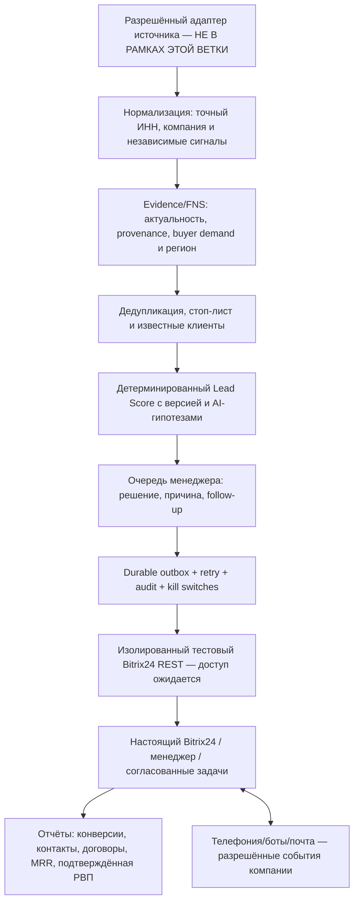

# «Сервис ИТ» — архитектура MVP без источников, технический паспорт и карта приёмки

**Основание:** оригинальный документ от Микаила «ТЗ_система_лидогенерации_Сервис_ИТ_итоговое.docx», v3.0 (август 2026), письмо 30.10.2026. Соответствие требований — не равно фактическому внедрению в Битрикс24/АТС.

## Архитектурные уровни (источники вынесены за границу)

**Разделение ответственности:** 1) источник никогда не санкционирует рекламу/создание CRM; 2) ИНН — ключ юридического лица, сигнал — отдельная независимая сущность; 3) AI не подменяет проверенные факты, scoring и решения менеджера; 4) стоп-лист перепроверяется перед каждым реальным действием; 5) Bitrix24 является системой учёта, локальная SQLite — исследовательский/операционный этап; 6) реальные финансовые события подтверждаются в системах компании, не генерируются AI.

## Что уже реально реализовано в main до этой ветки

- `leadpilot/core.py`: нормализация 10/12-значного ИНН **без проверки контрольной суммы в демо**, отдельные компании и сигналы в SQLite, дедупликация по ИНН, ручной review при совпадении phone/email разных ИНН, стоп-лист, версия Lead Score, аудит.
- `leadpilot/review_pipeline.py`, `leadpilot/manager_briefs.py`: отдельные evidence/manager cards с безопасными ограничениями, без утверждения коммерческого спроса из косвенных сигналов.
- `leadpilot/crm_contract.py`: **in-memory** симуляция Led/Signal/Task с повтором, но не продакшен-CRM.
- `leadpilot/bitrix_sandbox.py`: read-only проверка тестовой воронки по REST (без выданного портала не запускалась).
- `leadpilot/web.py` + `START_LAB.ps1`: локальная демо-панель, данные синтетические; готовая для презентации, **не** личный кабинет с авторизацией.
- `leadpilot/finance.py`: только пример формулы расчётной валовой прибыли, **не** начисление реальных выплат.

## Что добавлено этой отдельной веткой без источников

- `leadpilot/workflow_ops.py` — постоянные таблицы SQLite для решения менеджера (причина и дата), операций **только для симулятора**, журнала действий; `(company_id,signal_id)` уникальный ключ; повторы без двойной операции, повторная проверка существующего клиента/стоп-листа/срока сигнала перед обработкой. Ролевой параметр **не является реальной аутентификацией** и не может быть использован как разрешение на коммуникации; подтверждённые manager reviews не разрешают запись CRM.
- `leadpilot/architecture_demo.py` — демонстрация С ИНТЕГРАЦИЕЙ ЧЕРЕЗ ЛОКАЛЬНУЮ ЛОГИКУ: синтетический ввод компании, повторные сигналы, scoring, проверка менеджером, недоступность симулятора CRM и безопасный повтор, стоп-лист, события аудита. Создаёт отдельно HTML и JSON для показа Микаилу, **без сети**. В HTML крупно написано «ДЕМОНСТРАЦИЯ» и помечены все неподключённые сервисы.
- `tests/test_workflow_ops.py`, `tests/test_architecture_demo.py`: offline acceptance сценарии, включая запрет сетевых/реальных CRM действий.
- `scripts/RUN_SERVICEIT_ARCHITECTURE_DEMO.ps1`: запускает только эти тесты и создание HTML/JSON. **Результат на Windows владельца ещё не подтверждён** до фактического лога.

## Невыполненные условия, которые нельзя закрыть одним GitHub-коммитом

| По ТЗ | Что необходимо от «Сервис ИТ» | Критерий реальной готовности |
|---|---|---|
| §9 CRM/воронка/поля/роли | Отдельная тестовая воронка или смарт-процесс, схема полей, действующая CRM, ограниченные права | Реальный read-only аудит, затем разрешённая тестовая запись и clean-up, проверка дублирования и роботизации |
| §7 и §14 поручения менеджерам | Роли/ответственные, схема заданий и стадии компании | Реальная карточка, задача, история и следующий шаг в Bitrix24 с согласованными разрешениями |
| §15 стоп-лист | Копия правил/возможность безопасного чтения действующих клиентов и запретов | Канальные запреты проверяются перед каждым реальным действием; нет спама после отказа |
| §10 АТС Билайн | Выделенный московский номер, учётная запись/события, техдокументы, разрешение | Настоящий исходящий звонок менеджера с логированием в CRM, без массовых авто-робозвонков |
| §11 почта | Выделенный отправитель, SPF/DKIM/DMARC и законное основание | Подтверждённая доставка разрешённого теста без использования почты поддержки для массовых рассылок |
| §12 боты | Тестовые Telegram/WhatsApp/MAX конфигурации и согласование событий | Контролируемое входящее сообщение → задача/история CRM без отправки спама |
| §18 роли | Корпоративная аутентификация, матрица разрешений, владелец CRM | Менеджер не меняет системные поля и видит только назначенные карточки |
| §16 KPI + §25 РВП | Реальные подтверждённые сделки, оплаты и расходы; роли и проценты | Расчёты по реальным событиям с неизменяемым аудитом, без вымышленных продаж |
| §19 устойчивость | Подтверждённые hosting, backups, monitoring, staging, administrator | Развёрнутый сервис, журнал инцидентов, резервное восстановление, kill switch, review безопасности |
| §20/21 приёмка и сдача | Разрешённый изолированный портал и представитель Заказчика | Письменная приёмка сценариев, рабочие регламенты, доступы, обученные роли |

## Демонстрация Микаилу до доступов компании

1. Запустить **локальный** `START_LAB.ps1` (из текущего main) и показать компании, score, причины, стоп-лист — это DEMO, не реальные лиды.
2. В отдельном worktree с этой веткой запустить `scripts/RUN_SERVICEIT_ARCHITECTURE_DEMO.ps1`; открыть `exports/architecture_showcase.html`. Показать безопасный повтор, менеджера, отказ и недублирование по ИНН. Не утверждать, что Bitrix24 работает.
3. Показать **отдельно** факт `EIS_REPAIR_PROBE=PASS` и 108 уникальных закупок; не показывать их как реальные B2B продажи/готовые клиентские карточки.
4. Согласовать с Микаилом поля, стоп-листы, полномочия и критерии квалифицированного лида по 1С в Москве/МО, а затем получить ограниченный тестовый REST.
5. На CRM-тестовом контуре проверить заранее утверждённую схему и синтетический элемент. Живые записи/звонки/почта **только после отдельного согласования**.

### Статус

**ARCHITECTURE_DESIGN = SUBSTANTIAL; LOCAL_ARCHITECTURE_DEMO = IMPLEMENTED_IN_BRANCH_NOT_HOST_ACCEPTED; REAL_COMPANY_INTEGRATIONS = NOT_VERIFIED; PRODUCTION_MVP = NOT_ACCEPTED.**

Не путать готовую архитектурную схему и локальную имитацию с реально развернутой информационной системой компании. Полный scope ТЗ v3.0 включает реальную CRM, АТС, входящие боты, аналитику оплаты/РВП, безопасность и приёмку; эти факты нельзя подменить дополнительными исходниками Python. Период 4–6 недель из §17 — длительность реального пилота после запуска, не дедлайн разработки.

## 31.10.2026 — доказано наличие приглашения, подготовлены задачи менеджера (offline)

Проверено из Gmail письмо **«Приглашение в Битрикс24»** от 31.10.2026: настоящий портал организации `serviseit.bitrix24.ru`. Персональная ссылка приглашения с секретом **не раскрывается**. Пользователь готов выполнить первый вход позже, когда закончится вся подготовка локальной архитектуры. **Вход, проверка прав, REST и CRM writes ещё не производились.** Подробнее: `docs/BITRIX24_CORPORATE_ONBOARDING_PRECHECK.md`.

Добавлен `leadpilot/manager_workspace_demo.py`: локальные SQLite manager tasks, next action, due date, simulated `FOLLOW_UP`/feedback, idempotent event key, защита от повторного назначения по `(company_id,signal_id)`, повторная проверка существующего клиента/стоп-листа до события. **Только заранее обозначенные synthetic source names**; реальные источники и реальные CRM контакты намеренно не принимаются. В `architecture_demo.py` добавлен реальный прогон этой локальной имитации: назначение задачи, повторное касание, отсутствие дубля. Тесты `tests/test_manager_workspace_demo.py` добавлены к операторскому запуску.

Эти действия закрывают **локальную архитектурную демонстрацию**, но не corporate task API и RBAC. Изолированная CRM остаётся отдельным обязательным этапом.
