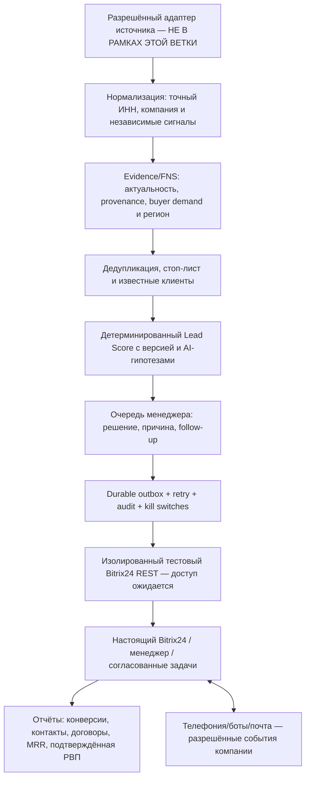

# «Сервис ИТ» — архитектура MVP без источников, технический паспорт и карта приёмки

**Основание:** оригинальный документ от Микаила «ТЗ_система_лидогенерации_Сервис_ИТ_итоговое.docx», v3.0 (август 2026), письмо 30.10.2026. Соответствие требований — не равно фактическому внедрению в Битрикс24/АТС.

## Архитектурные уровни (источники вынесены за границу)



**Разделение ответственности:** 1) источник никогда не санкционирует рекламу/создание CRM; 2) ИНН — ключ юридического лица, сигнал — отдельная независимая сущность; 3) AI не подменяет проверенные факты, scoring и решения менеджера; 4) стоп-лист перепроверяется перед каждым реальным действием; 5) Bitrix24 является системой учёта, локальная SQLite — исследовательский/операционный этап; 6) реальные финансовые события подтверждаются в системах компании, не генерируются AI.

## Что уже реально реализовано в main до этой ветки

- `leadpilot/core.py`: нормализация 10/12-значного ИНН **без проверки контрольной суммы в демо**, отдельные компании и сигналы в SQLite, дедупликация по ИНН, ручной review при совпадении phone/email разных ИНН, стоп-лист, версия Lead Score, аудит.
- `leadpilot/review_pipeline.py`, `leadpilot/manager_briefs.py`: отдельные evidence/manager cards с безопасными ограничениями, без утверждения коммерческого спроса из косвенных сигналов.
- `leadpilot/crm_contract.py`: **in-memory** симуляция Led/Signal/Task с повтором, но не продакшен-CRM.
- `leadpilot/bitrix_sandbox.py`: read-only проверка тестовой воронки по REST (без выданного портала не запускалась).
- `leadpilot/web.py` + `START_LAB.ps1`: локальная демо-панель, данные синтетические; готовая для презентации, **не** личный кабинет с авторизацией.
- `leadpilot/finance.py`: только пример формулы расчётной валовой прибыли, **не** начисление реальных выплат.

## Что добавлено этой отдельной веткой без источников

- `leadpilot/workflow_ops.py` — постоянные таблицы SQLite для решения менеджера (причина и дата), операций **только для симулятора**, журнала действий; `(company_id,signal_id)` уникальный ключ; повторы без двойной операции, повторная проверка существующего клиента/стоп-листа/срока сигнала перед обработкой. Ролевой параметр **не является реальной аутентификацией** и не может быть использован как разрешение на коммуникации; подтверждённые manager reviews не разрешают запись CRM.
- `leadpilot/architecture_demo.py` — демонстрация С ИНТЕГРАЦИЕЙ ЧЕРЕЗ ЛОКАЛЬНУЮ ЛОГИКУ: синтетический ввод компании, повторные сигналы, scoring, проверка менеджером, недоступность симулятора CRM и безопасный повтор, стоп-лист, события аудита. Создаёт отдельно HTML и JSON для показа Микаилу, **без сети**. В HTML крупно написано «ДЕМОНСТРАЦИЯ» и помечены все неподключённые сервисы.
- `tests/test_workflow_ops.py`, `tests/test_architecture_demo.py`: offline acceptance сценарии, включая запрет сетевых/реальных CRM действий.
- `scripts/RUN_SERVICEIT_ARCHITECTURE_DEMO.ps1`: запускает только эти тесты и создание HTML/JSON. **Результат на Windows владельца ещё не подтверждён** до фактического лога.

## Невыполненные условия, которые нельзя закрыть одним GitHub-коммитом

| По ТЗ | Что необходимо от «Сервис ИТ» | Критерий реальной готовности |
|---|---|---|
| §9 CRM/воронка/поля/роли | Отдельная тестовая воронка или смарт-процесс, схема полей, действующая CRM, ограниченные права | Реальный read-only аудит, затем разрешённая тестовая запись и clean-up, проверка дублирования и роботизации |
| §7 и §14 поручения менеджерам | Роли/ответственные, схема заданий и стадии компании | Реальная карточка, задача, история и следующий шаг в Bitrix24 с согласованными разрешениями |
| §15 стоп-лист | Копия правил/возможность безопасного чтения действующих клиентов и запретов | Канальные запреты проверяются перед каждым реальным действием; нет спама после отказа |
| §10 АТС Билайн | Выделенный московский номер, учётная запись/события, техдокументы, разрешение | Настоящий исходящий звонок менеджера с логированием в CRM, без массовых авто-робозвонков |
| §11 почта | Выделенный отправитель, SPF/DKIM/DMARC и законное основание | Подтверждённая доставка разрешённого теста без использования почты поддержки для массовых рассылок |
| §12 боты | Тестовые Telegram/WhatsApp/MAX конфигурации и согласование событий | Контролируемое входящее сообщение → задача/история CRM без отправки спама |
| §18 роли | Корпоративная аутентификация, матрица разрешений, владелец CRM | Менеджер не меняет системные поля и видит только назначенные карточки |
| §16 KPI + §25 РВП | Реальные подтверждённые сделки, оплаты и расходы; роли и проценты | Расчёты по реальным событиям с неизменяемым аудитом, без вымышленных продаж |
| §19 устойчивость | Подтверждённые hosting, backups, monitoring, staging, administrator | Развёрнутый сервис, журнал инцидентов, резервное восстановление, kill switch, review безопасности |
| §20/21 приёмка и сдача | Разрешённый изолированный портал и представитель Заказчика | Письменная приёмка сценариев, рабочие регламенты, доступы, обученные роли |

## Демонстрация Микаилу до доступов компании

1. Запустить **локальный** `START_LAB.ps1` (из текущего main) и показать компании, score, причины, стоп-лист — это DEMO, не реальные лиды.
2. В отдельном worktree с этой веткой запустить `scripts/RUN_SERVICEIT_ARCHITECTURE_DEMO.ps1`; открыть `exports/architecture_showcase.html`. Показать безопасный повтор, менеджера, отказ и недублирование по ИНН. Не утверждать, что Bitrix24 работает.
3. Показать **отдельно** факт `EIS_REPAIR_PROBE=PASS` и 108 уникальных закупок; не показывать их как реальные B2B продажи/готовые клиентские карточки.
4. Согласовать с Микаилом поля, стоп-листы, полномочия и критерии квалифицированного лида по 1С в Москве/МО, а затем получить ограниченный тестовый REST.
5. На CRM-тестовом контуре проверить заранее утверждённую схему и синтетический элемент. Живые записи/звонки/почта **только после отдельного согласования**.

### Статус

**ARCHITECTURE_DESIGN = SUBSTANTIAL; LOCAL_ARCHITECTURE_DEMO = IMPLEMENTED_IN_BRANCH_NOT_HOST_ACCEPTED; REAL_COMPANY_INTEGRATIONS = NOT_VERIFIED; PRODUCTION_MVP = NOT_ACCEPTED.**

Не путать готовую архитектурную схему и локальную имитацию с реально развернутой информационной системой компании. Полный scope ТЗ v3.0 включает реальную CRM, АТС, входящие боты, аналитику оплаты/РВП, безопасность и приёмку; эти факты нельзя подменить дополнительными исходниками Python. Период 4–6 недель из §17 — длительность реального пилота после запуска, не дедлайн разработки.


## 31.10.2026 — доказано наличие приглашения, подготовлены задачи менеджера (offline)

Проверено из Gmail письмо **«Приглашение в Битрикс24»** от 31.10.2026: настоящий портал организации `serviseit.bitrix24.ru`. Персональная ссылка приглашения с секретом **не раскрывается**. Пользователь готов выполнить первый вход позже, когда закончится вся подготовка локальной архитектуры. **Вход, проверка прав, REST и CRM writes ещё не производились.** Подробнее: `docs/BITRIX24_CORPORATE_ONBOARDING_PRECHECK.md`.

Добавлен `leadpilot/manager_workspace_demo.py`: локальные SQLite manager tasks, next action, due date, simulated `FOLLOW_UP`/feedback, idempotent event key, защита от повторного назначения по `(company_id,signal_id)`, повторная проверка существующего клиента/стоп-листа до события. **Только заранее обозначенные synthetic source names**; реальные источники и реальные CRM контакты намеренно не принимаются. В `architecture_demo.py` добавлен реальный прогон этой локальной имитации: назначение задачи, повторное касание, отсутствие дубля. Тесты `tests/test_manager_workspace_demo.py` добавлены к операторскому запуску.

Эти действия закрывают **локальную архитектурную демонстрацию**, но не corporate task API и RBAC. Изолированная CRM остаётся отдельным обязательным этапом.


## Windows host run 31.10.2026 — устранение реальной ошибки SQLite Temp cleanup

**Нельзя считать старую host acceptance зелёной:** пользователь запустил предыдущий операторский архив `ServiceIT_ARCHITECTURE_SHOWCASE_OPERATOR_20261031.zip`, pinned исторический SHA `3dc9670...`. Вывод: `9 passed, 2 failed`; обе ошибки в `tests/test_architecture_demo.py` были `PermissionError [WinError 32]` при удалении `%TEMP%/serviceit-architecture-demo-*/demo.sqlite3`, то есть демонстрационный процесс сохранил открытый дескриптор SQLite до выхода из `TemporaryDirectory`. **Нет доказательств сбоя алгоритма дедупликации/Bitrix24/ЕИС**. На Windows конструкция `with sqlite3.connect(path) as con:` управляет транзакцией, **но не закрывает connection**.

Исправлено в этом PR:
- `leadpilot/architecture_demo.py`: оба локальных соединения закрываются через `contextlib.closing`; вместо вызова `core.metrics` (использующего обычный SQLite transaction context manager) статический synthetic reporting делает прямые `SELECT` в явно закрываемом соединении, **не меняя core.py**.
- `leadpilot/workflow_ops.py` и `leadpilot/manager_workspace_demo.py`: `report`/`overview` закрывают SQLite через `closing`.
- Два ранее упавших `tests/test_architecture_demo.py` запускают `simulate()` в `TemporaryDirectory` и тем самым служат регрессией для Windows file-lock cleanup.

**Fix STATUS = COMMITTED, WINDOWS_RETEST_PENDING.** До нового реального Windows прогона нельзя объявлять `ARCH_SHOWCASE_ACCEPTANCE=PASS`. Старая версия скачанного ZIP закреплена на старом SHA; для повторной проверки использовать новый архив, предоставленный после этого исправления.


## 31.10.2026 — WinError 32 при завершении временной SQLite (исправление после второго воспроизведения)

На Windows пользователь дважды воспроизвёл `PermissionError [WinError 32]` при завершении `TemporaryDirectory`:
- первый запуск: **9 passed, 2 failed**;
- второй запуск после частичного исправления `architecture_demo.py`: **14 passed, 2 failed**. Это **не PASS**.
- ошибка указывала на временный путь `%TEMP%\\serviceit-architecture-demo-*\\demo.sqlite3`, который удерживался открытым.

**Точная первопричина:** в *ранее существующем* `leadpilot/core.py` функции `initialize`, `get_leads` и `metrics` использовали `with sqlite3.connect(...) as con`. Менеджер контекста `sqlite3.Connection` завершает транзакцию, но **не закрывает подключение**; поэтому с открытым дескриптором Windows не удаляет файл. Раннее исправление только `architecture_demo`/новых модулей было неполным.

Ремонт в этой ветке: импорт `contextlib.closing`, замена **трёх** ключевых контекстов на `with closing(sqlite3.connect(...)) as con`; существующий `core.transaction` уже имел явный `finally: con.close()` и не изменён. Это не меняет структуру таблиц/нормализацию/скоринг; только освобождение read/initialization-соединений после использования.

Добавлен `tests/test_sqlite_windows_cleanup.py`: `TrackedSQLiteConnection` записывает все открытые соединения через monkeypatch `sqlite3.connect`; `close()` ставит флаг. Три сценария проверяют (1) `initialize/get_leads/metrics` на пустой базе, (2) **весь `architecture_demo.simulate()`**, (3) `ingest+qualify+get_leads+metrics` с синтетическими данными. Наличие любого соединения без `close()` блокирует регрессию даже на Linux. Оператор `RUN_SERVICEIT_ARCHITECTURE_DEMO.ps1` теперь требует прохождения этих тестов ДО создания HTML.

**Важно:** патч сохранён в GitHub, повторной Windows-приёмки ещё нет. Условие завершения: `SERVICEIT_ARCH_PREBITRIX=PASS_SYNTHETIC_ONLY`, отсутствие `WinError 32`, сохранение HTML/JSON и никаких CRM/других источников.


## 31.10.2026 — подтверждена независимая Windows-приёмка локальной архитектуры

Оператор запустил закреплённую версию `ea48d90394f07e86230923b3a1e80efbac2ba1b0` в отдельном worktree. Это **реальный пользовательский лог**:

```text
SERVICEIT_ARCH_CODE_SHA=ea48d90394f07e86230923b3a1e80efbac2ba1b0
SERVICEIT_ARCH_DEMO=TEST_START; MODE=SYNTHETIC_ONLY; CRM_WRITES=NO
................... [100%]
19 passed in 2.72s
ARCH_SHOWCASE=CREATED_LOCAL_SYNTHETIC_ONLY
MANAGER_REVIEW_AND_RETRY=SIMULATED_PASS; CRM_WRITES=NO; REAL_LEADS=0
SERVICEIT_ARCH_DEMO=PASS_LOCAL_SYNTHETIC_ONLY; REAL_CRM=DISCONNECTED
SERVICEIT_ARCH_ACCEPTANCE_EXIT=0
SERVICEIT_ARCH_SQLITE_CLOSE_REGRESSION=PASS_IF_TESTS_GREEN
SERVICEIT_ARCH_PREBITRIX=PASS_SYNTHETIC_ONLY; CRM_WRITES=NO; CONTACTS=NONE
```

Результаты показаны в `%LOCALAPPDATA%\\ServiceIT\\Architecture-Acceptance\\run-20261031T190602349Z\\exports\\architecture_showcase.html`, локальный JSON в соседнем файле. Два предыдущих прогона с `WinError32` имели 9/14 passed + 2 failed и **не были успешными**. Третий прогон, после исправления именно `core.initialize/get_leads/metrics`, действительно PASS, временная база успешно очищена.

**Что теперь закрыто:** только локальная синтетическая архитектурная приёмка; включая постоянное хранение решений менеджера, защиту от дублей в симуляции, задачи и follow-up в симуляции, повторную обработку и stop checks, безопасный HTML showcase, регрессионный контроль SQLite close.

**Что не доказано этим PASS:** реальный доступ и полномочия Bitrix24, API записи, CRM matching existing clients/opt-outs, production RBAC, корпоративные call/email/bot events, реальные пользовательские данные, финансовые договоры/РВП и production deployment. Проект по-прежнему не должен создавать реальные CRM-лиды или контакты автоматически. Приглашение в `serviseit.bitrix24.ru` получено, но корпоративный портал не был проверен изнутри.

Приёмка локальной части подтверждена именно зафиксированным pinned SHA. Позднейшие коммиты в PR потребуют собственной повторной проверки, если затронут логику.
